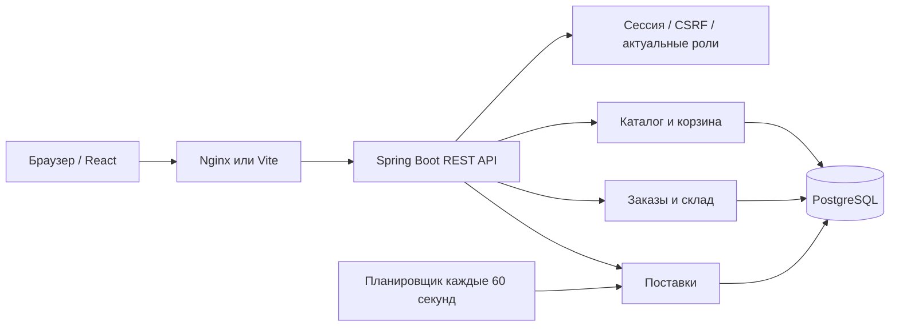

# Архитектура



## Транзакции и блокировки

Оформление блокирует строку покупателя, затем строки товаров в порядке ID. Это сериализует оформление одним покупателем и исключает превышение остатков. Ключ `(user_id, request_key)` уникален: повтор оформления возвращает существующий заказ. Отсутствие товара откатывает заказ, строки заказа, резервы и движения вместе.

Статусные операции блокируют заказ, затем его товары в порядке ID. Принятие поставки и планировщик блокируют товар перед строкой поставки. Повтор того же статуса возвращает текущее состояние без движения.

Физический остаток `stock` включает резерв `reserved`. Доступно `stock - reserved`. При заказе увеличивается только резерв, при отгрузке уменьшаются оба, при отмене резерв освобождается. Ограничения БД запрещают отрицательные значения и резерв больше физического остатка.

Планировщик берёт блокировку перед расчётом уже ожидаемого количества, поэтому два экземпляра приложения не создают одинаковое пополнение. При ошибке транзакция откатывается и повторяется в следующий запуск; журнал приложения содержит причину. Это периодический повтор, без отдельной очереди с экспоненциальной задержкой.

## Формула пополнения

```text
forecast = ceil(продано за последние 14 дней / 14 × 7)
goal = max(целевой запас, forecast)
trigger = max(минимальный остаток, forecast / 2)
incoming = сумма REQUESTED + CONFIRMED + IN_TRANSIT
если available <= trigger:
  quantity = goal - available - incoming
  создать заявку, только если quantity > 0
```

Продажи учитываются для отгруженных и доставленных заказов. Частично принятая поставка считается закрытой; недостача зафиксирована в количестве и комментарии. Следующий запуск может создать новую заявку, если снова достигнут порог.

## Доступ

Регистрация всегда создаёт покупателя. Назначать роли может администратор. Сессии хранятся в памяти сервера и завершаются при его перезапуске. Роль и блокировка считываются из БД на каждом запросе: старая сессия не сохраняет отозванные права. Для нескольких экземпляров сервера потребуется общее хранилище сессий.

Cookie — HttpOnly, SameSite=Lax; Secure включается переменной окружения при HTTPS. Все изменения требуют CSRF-токена. Пароли хешируются BCrypt. Продавец ограничен своими товарами и поставками; покупатель — своими заказами, корзиной и избранным. Доступ администратора и склада дополнительно ограничен маршрутами Spring Security.

## Осознанные упрощения

Модульный монолит и единый JPA Store вместо отдельного репозитория на каждую сущность сокращают повторяющийся код. Статусы хранятся строками, допустимые переходы проверяются сервисами. Деньги — BigDecimal/NUMERIC. DTO валидируются на входе; JPA-модели используются в части ответов, поле пароля исключено из сериализации.

Для промышленной эксплуатации нужны ограничение частоты входа, восстановление пароля, подтверждение почты, централизованные сессии, резервное копирование, наблюдаемость, аудит всех бизнес-операций, внешние платежи и доставка. Демонстрационные аккаунты нельзя оставлять на публичном сервере.
